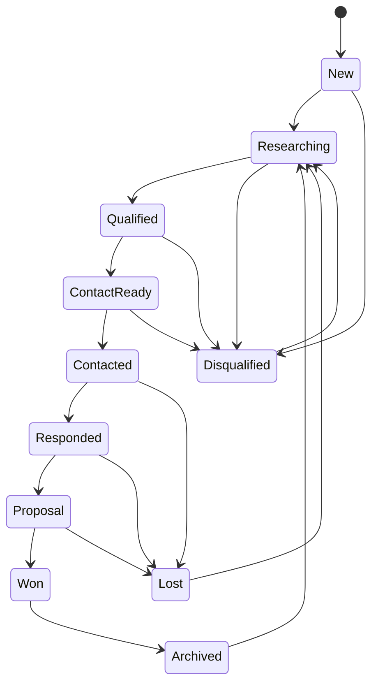

# Lead Intelligence

Aplicação full-stack para organizar negócios potenciais, registrar pesquisa e acompanhar o pipeline de prospecção B2B — com busca de empresas via Google Places API (New). **A aplicação nunca envia mensagens**: todo contato permanece sob ação explícita do usuário.

   

## Destaques técnicos

- **Domínio rico**: `Lead` encapsula estado e invariantes (setters privados, normalização de entrada, máquina de estados em `TryTransitionTo`); transições inválidas retornam `409 Conflict` com `ProblemDetails`.
- **Ciclo de vida explícito**: 11 status e tabela de transições permitidas, coberta por testes unitários (xUnit) — ex.: não é possível pular de `New` para `Contacted`.
- **Integração externa com cuidado operacional**: cliente `HttpClient` tipado para Places API (New) com *field mask* mínimo, tratamento diferenciado de 429/403/400/timeout e redação do header `X-Goog-Api-Key` nos logs.
- **Conformidade com termos de uso**: resultados do Google são exibidos temporariamente e **não persistidos**; apenas o `place_id` (permitido pela política) é guardado, com checagem de duplicidade.
- **Segurança**: chave de API só no backend, CORS restrito a origens locais, validação de entrada (`DataAnnotations` + atributo customizado `HttpUrl` que restringe a `http`/`https`), `.env` fora do versionamento.
- **Persistência**: EF Core + Npgsql, migrações aplicadas automaticamente na inicialização, PostgreSQL via Docker Compose com *healthcheck*.
- **Frontend moderno**: Angular 22 (componentes standalone, roteamento por página), TypeScript, testes com Vitest.

## Arquitetura

```mermaid
flowchart LR
    UI["Angular 22<br/>(localhost:4200)"] -->|REST/JSON| API["ASP.NET Core API<br/>(.NET 10)"]
    API -->|EF Core / Npgsql| DB[("PostgreSQL 17")]
    API -->|Text Search (New)| GP["Google Places API"]
```

```
backend/
  src/LeadIntelligence.Api/
    Controllers/   Leads, Dashboard, Places
    Domain/        Lead (agregado + máquina de estados), LeadStatus
    Contracts/     DTOs e validação de entrada
    Services/      PlacesSearchService (integração Google)
    Data/          AppDbContext e migrações
  tests/LeadIntelligence.Api.Tests/   testes de domínio (xUnit)
frontend/src/app/
  pages/           dashboard, leads, lead-detail, prospecting
  lead.service.ts  cliente HTTP tipado (+ spec)
```

### Ciclo de vida do lead



Retornos intermediários (ex.: `Researching → New`, `Responded → ContactReady`) e arquivamento a partir de qualquer estado também são permitidos; a fonte da verdade é `Domain/Lead.cs`.

## Funcionalidades

- CRUD de leads com busca paginada (nome/descrição); a API também filtra por status, cidade e categoria.
- Painel com contagens e funil do pipeline (descoberto → qualificado → pronto p/ contato → contatado → respondeu → proposta → ganho).
- **Encontrar empresas**: busca textual (ex.: “clínicas odontológicas em Campinas”) com até 10 resultados e atribuição **Google Maps**; “Revisar e adicionar” abre o cadastro vazio, preenchido a partir de fonte independente.
- Interface em português.

## API

| Método | Rota | Descrição |
|---|---|---|
| GET | `/api/leads` | Lista paginada (`search`, `status`, `city`, `category`, `page`, `pageSize` ≤ 100) |
| GET | `/api/leads/{id}` | Detalhe |
| POST | `/api/leads` | Cria (409 se `place_id` duplicado) |
| PUT | `/api/leads/{id}` | Atualiza |
| PATCH | `/api/leads/{id}/status` | Transição de status (409 se inválida) |
| DELETE | `/api/leads/{id}` | Remove |
| GET | `/api/dashboard` | Métricas e funil |
| POST | `/api/places/search` | Busca no Google Places |

OpenAPI em desenvolvimento: `http://localhost:5000/openapi/v1.json`.

## Executar localmente

Pré-requisitos: .NET 10 SDK, Node.js 24+, Docker com Compose.

```bash
docker compose up -d postgres                       # banco em localhost:5433
dotnet run --project backend/src/LeadIntelligence.Api   # API em :5000 (aplica migrações)
cd frontend && npm install && npm start             # UI em :4200
```

Configuração (veja `.env.example`):

| Variável | Uso |
|---|---|
| `POSTGRES_PASSWORD` | Senha do Compose; repasse a mesma à API via `ConnectionStrings__Database` ou `DATABASE_URL` |
| `GOOGLE_MAPS_API_KEY` / `GooglePlaces__ApiKey` | Habilita a prospecção (opcional) |

Sem a chave do Google o restante da aplicação funciona; a busca informa como configurá-la.

## Testes e build

```bash
dotnet test LeadIntelligence.slnx
dotnet build backend/src/LeadIntelligence.Api
cd frontend && npm test -- --watch=false && npm run build
```

## Prospecção com Google Places API (New)

- Habilite **Places API (New)** e faturamento no Google Cloud; restrinja a chave à API. Cada busca é faturável.
- Campos solicitados: `id`, nome, endereço, telefone internacional, site e categoria principal.
- Dados do Google não são persistidos como lead; só o `place_id` é associado. Antes de distribuição pública, publique Termos de Uso e Política de Privacidade que incorporem os do Google.
- Referências: [políticas](https://developers.google.com/maps/documentation/places/web-service/policies), [Text Search (New)](https://developers.google.com/maps/documentation/places/web-service/text-search), [preços e campos](https://developers.google.com/maps/documentation/places/web-service/data-fields).

## Decisões de design e limitações

- **Sem envio automático nem enriquecimento por IA**: escopo deliberado, mantém o humano no controle do contato.
- **Sem autenticação**: pensado para uso local de usuário único; autenticação e multiusuário seriam o próximo passo antes de qualquer deploy público.
- **Sem busca por proximidade**: o app não mantém coordenadas de pesquisa.
- **Próximos passos**: testes de integração dos controllers (`WebApplicationFactory`, `Program` já exposto), CI com GitHub Actions, histórico de transições (auditoria) e notas/atividades por lead.

## Autor

Gustavo Rost — [github.com/GustavoSRost](https://github.com/GustavoSRost)
